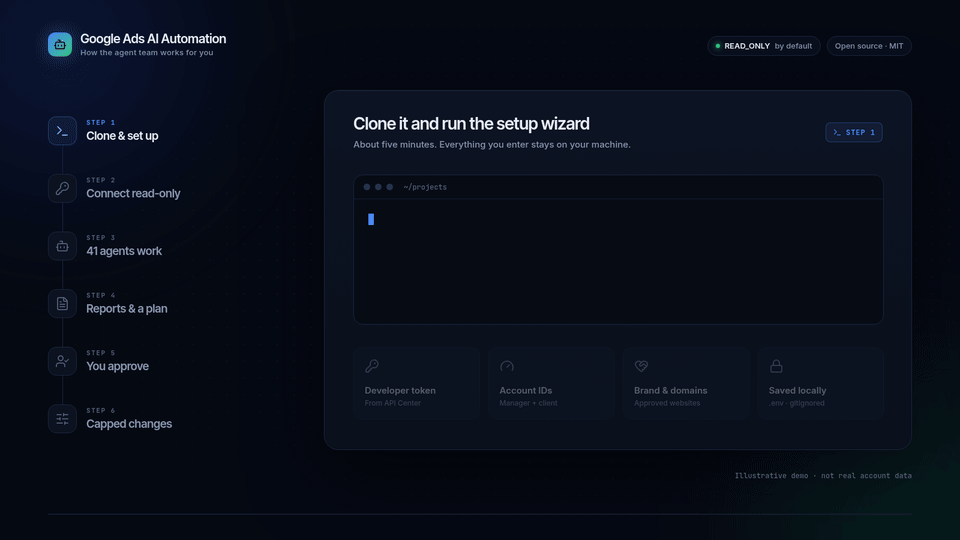
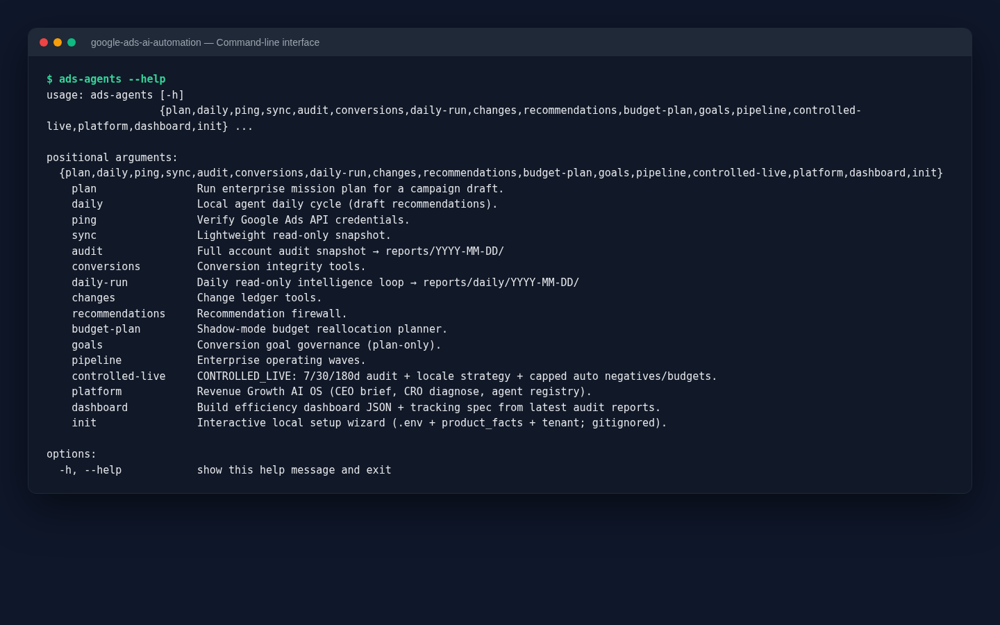
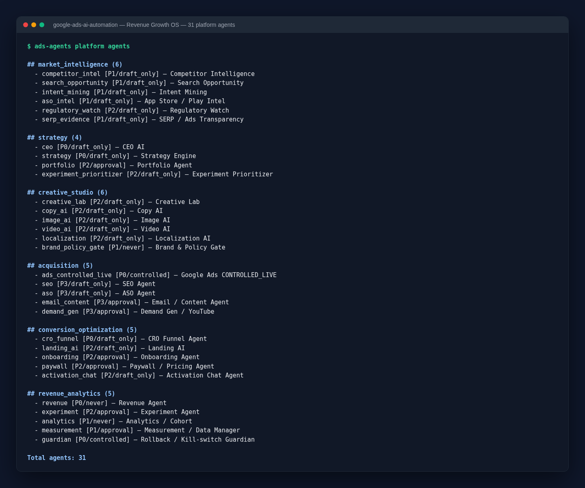
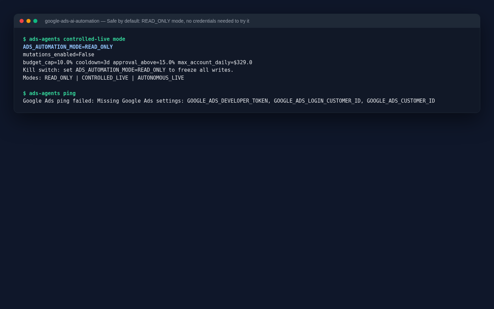
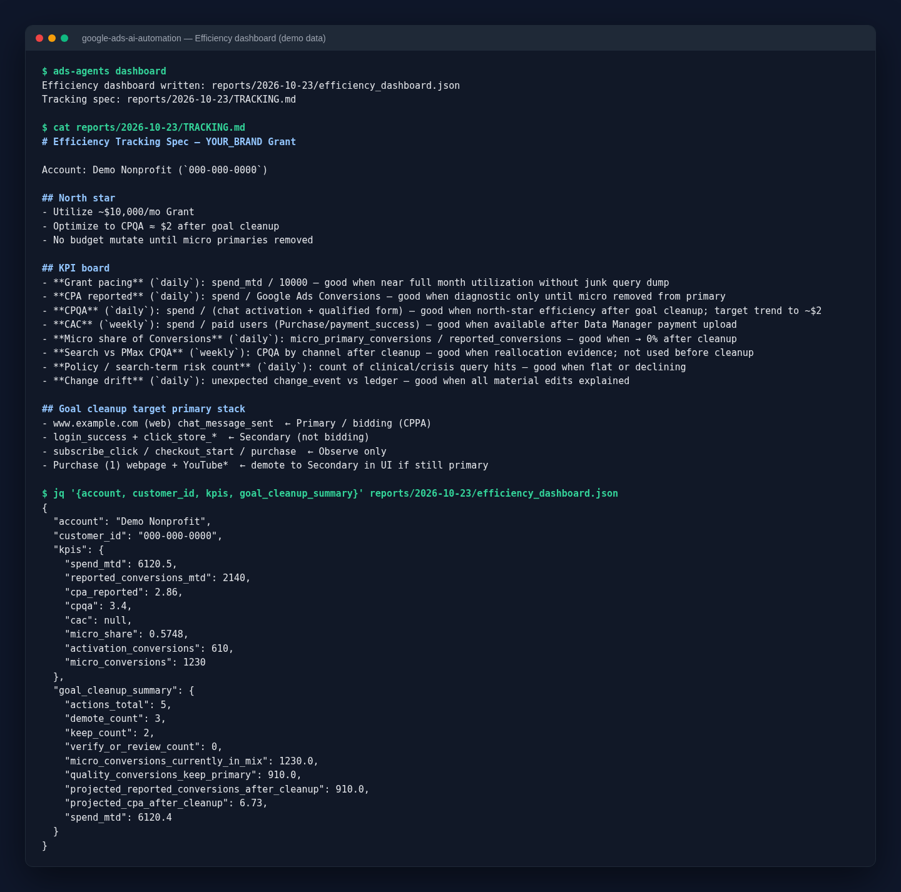
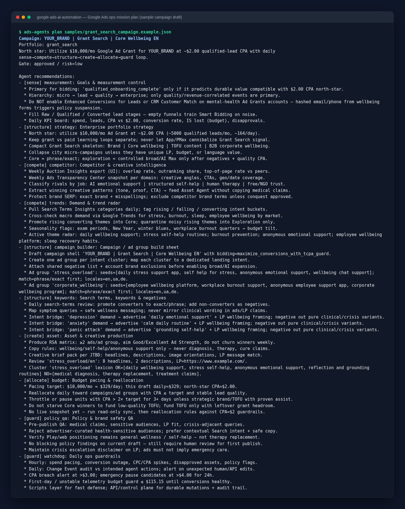
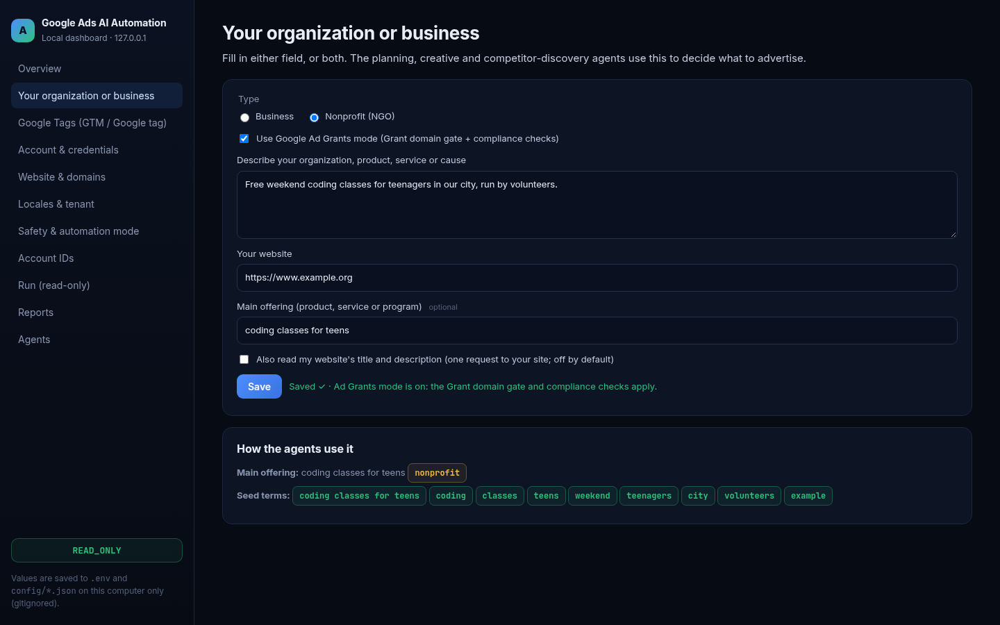
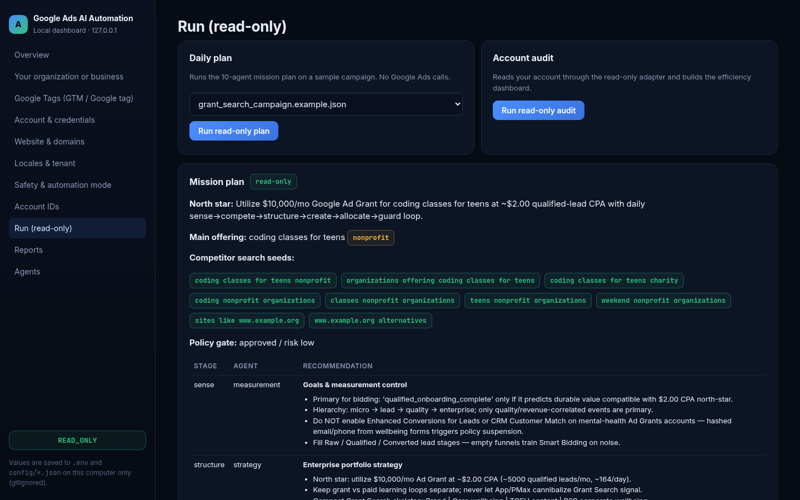
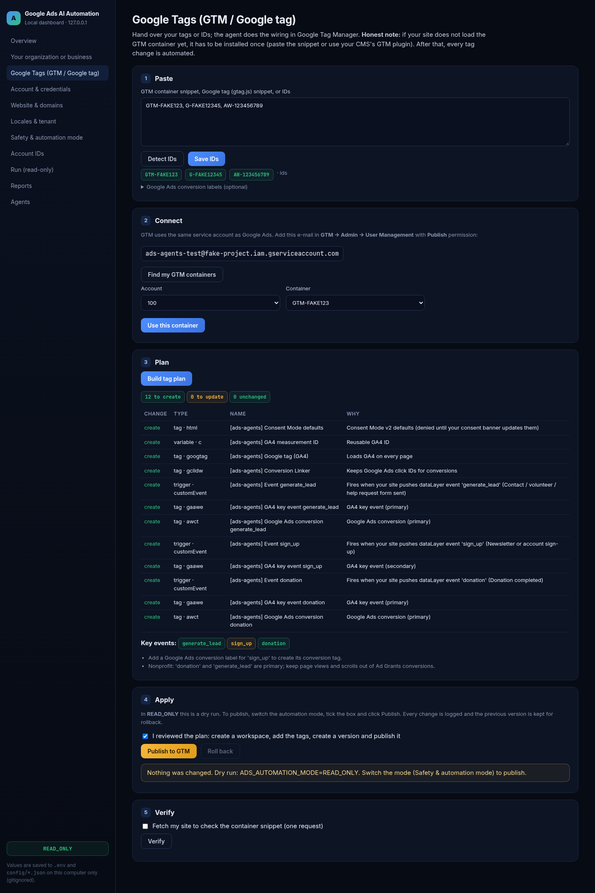
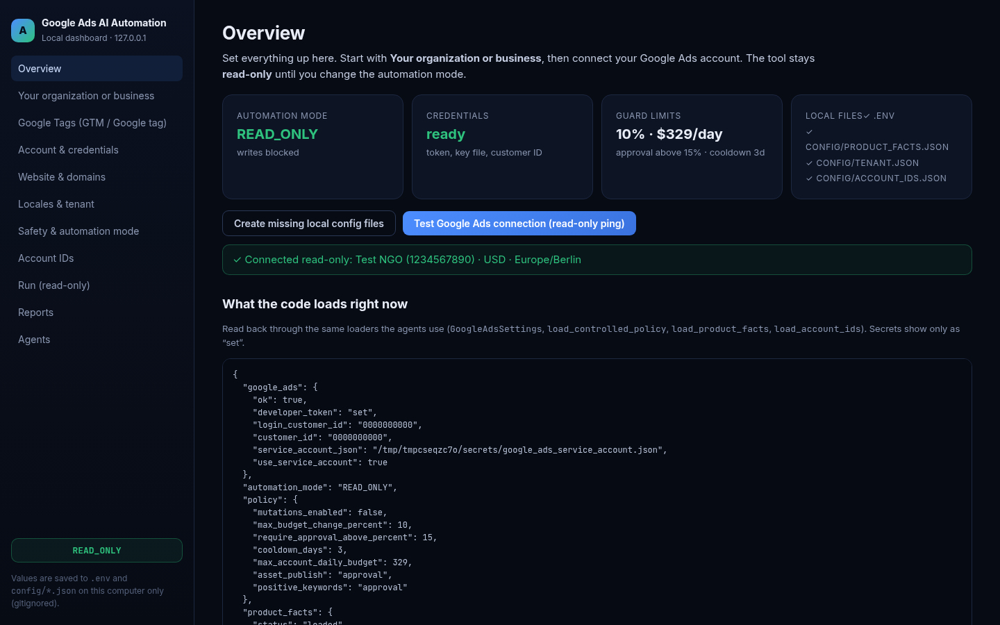

<div align="center">

# Google Ads AI Automation

**An open-source team of AI agents that watches, audits and plans your Google Ads, with a special focus on Google Ad Grants for nonprofits. It is read-only until you decide otherwise.**

[](https://www.python.org/downloads/)
[](LICENSE)
[](#-safety-first-how-it-protects-your-account)
[-purple)](docs/AGENTS.md)
[](https://developers.google.com/google-ads/api/docs/start)
[-orange)](#-project-status)

<br>



<sub>15-second overview, illustrative demo data. <a href="docs/images/agents-flow.mp4">Watch the full-quality MP4</a>.</sub>

</div>

---

## 🧭 What is this? (the 30-second version)

Running Google Ads well takes daily work. Someone has to check spend, look for wasted clicks, make sure conversions are tracked properly, follow policy rules, and plan the next changes. For **Google Ad Grants** (Google's free ~$10,000/month advertising for nonprofits) the rules are stricter still, and an account that breaks them can be suspended.

**Google Ads AI Automation** splits that work across a team of specialised software "agents". Each one has a single job: one checks your conversion tracking, another drafts keywords, another paces your budget, another blocks risky ad copy, and so on. They read your account through the official Google Ads API and write their findings as plain reports on your computer.

**By default nothing in your Google Ads account is changed.** The tool only reads and advises. Writing changes is a deliberate switch you have to turn on yourself.

### Who is it for?

| You are… | What you get |
| --- | --- |
| A **nonprofit** using Google Ad Grants | Daily checks against Ad Grants rules, budget pacing toward the monthly grant, and conversion-tracking clean-up advice |
| A **marketer or agency** managing Google Ads | A repeatable, auditable daily routine: audit → plan → (optionally) apply, with a change log and a kill switch |
| A **developer** | A Python 3.11 codebase with a CLI, a pluggable agent registry, write guards, and tests you can extend |

### For nonprofits (Google Ad Grants)

Nonprofits can get Grant campaigns set up quickly and keep them compliant without a full-time ads specialist. Alongside the commercial features, the toolkit ships guards built specifically for Ad Grants:

- **Grant domain gate.** Ads and sitelinks may only point to your approved, owned website. App Store, Google Play, YouTube and social links are blocked (`ads-agents platform grant-scrub-domains`).
- **Ad Grants compliance checklist** (`ads-agents platform grant-compliance`). It covers the 5% monthly CTR rule, no Quality Score 1–2 keywords, at least 2 ad groups and 2 sitelinks per campaign, at least one meaningful conversion a month and conversion-based Smart Bidding.
- **Grant budget pacing.** It paces spend toward the monthly grant under an account-wide daily cap (`ADS_MAX_ACCOUNT_DAILY_BUDGET`).
- **Reactivation helper** (`ads-agents platform grant-reactivate`). If an account was paused, it builds the fix list and the reactivation request.
- **Brand and policy gate and recommendation firewall.** Ad copy is checked before publishing, and Google's auto-recommendations are never applied blindly.

### Who can use it?

You do **not** need to be a programmer to try it. If you can copy and paste commands into a terminal, the 5-minute quick start below will work for you.

---

## ⚙️ How it works (in plain words)

```text
   Your Google Ads account
            │   (read through the official Google Ads API)
            ▼
 ┌─────────────────────────────────────────────────────────┐
 │  1. SENSE      What happened? Spend, clicks, conversions │
 │  2. COMPETE    What are competitors and searchers doing? │
 │  3. STRUCTURE  Are campaigns, ad groups, keywords right? │
 │  4. CREATE     Draft ads, sitelinks, images (policy-safe)│
 │  5. ALLOCATE   Where should the budget go?               │
 │  6. GUARD      Policy check, safety limits, kill switch  │
 └─────────────────────────────────────────────────────────┘
            │
            ▼
   Reports on your computer (reports/YYYY-MM-DD/)
   → you read them and decide
            │
            ▼   only if YOU switch the mode on
   Small, capped changes back to Google Ads (logged, reversible)
```

1. **You connect** your own Google Ads account (your keys stay on your machine).
2. **The agents read** the account and produce reports: an audit, a daily plan, a KPI dashboard file.
3. **You review** the recommendations.
4. **Optionally**, once you trust it, you allow small, capped changes. A safety guard blocks anything outside the limits, and a single setting freezes everything again.

---

## 🤖 The agents: 41 roles in two teams

The numbers below come straight from the live registry (`ads-agents platform agents`) and [`docs/AGENTS.md`](docs/AGENTS.md).

| Team | Agents | What they do |
| --- | ---: | --- |
| **Revenue Growth OS** (platform) | **31** | The "big picture": market intelligence, strategy, creative drafts, acquisition channels, conversion-rate optimisation, revenue and analytics |
| **Google Ads enterprise ops** | **10** | The daily Ads loop: sense → compete → structure → create → allocate → guard |
| **Total** | **41** | |

<details>
<summary><b>Revenue Growth OS: 31 platform agents in 6 layers</b> (click to expand)</summary>

| Layer | # | Agents |
| --- | ---: | --- |
| Market intelligence | 6 | Competitor Intelligence · Search Opportunity · Intent Mining · App Store / Play Intel · Regulatory Watch · SERP / Ads Transparency |
| Strategy | 4 | CEO AI · Strategy Engine · Portfolio Agent · Experiment Prioritizer |
| Creative studio | 6 | Creative Lab · Copy AI · Image AI · Video AI · Localization AI · Brand & Policy Gate |
| Acquisition | 5 | Google Ads CONTROLLED_LIVE · SEO Agent · ASO Agent · Email / Content Agent · Demand Gen / YouTube |
| Conversion optimisation | 5 | CRO Funnel Agent · Landing AI · Onboarding Agent · Paywall / Pricing Agent · Activation Chat Agent |
| Revenue & analytics | 5 | Revenue Agent · Experiment Agent · Analytics / Cohort · Measurement / Data Manager · Rollback / Kill-switch Guardian |

Every platform agent has a **mutation policy** that limits what it may do:
`never` (advise only) · `draft_only` (writes reports, never touches Ads) · `approval` (needs a human OK) · `controlled` (capped live writes, only in `CONTROLLED_LIVE` mode).

</details>

<details>
<summary><b>Google Ads enterprise ops: 10 agents</b> (click to expand)</summary>

| Agent | Stage | What it does |
| --- | --- | --- |
| MeasurementAgent | Sense | Checks conversion tracking and cost-per-result health |
| CompetitorAgent | Compete | Competitor and auction-pressure notes |
| TrendAgent | Compete | Demand and trend refresh |
| StrategyAgent | Structure | Portfolio and campaign-structure recommendations |
| CampaignBuilderAgent | Structure | Campaign and ad-group drafts |
| KeywordAgent | Structure | Keyword and negative-keyword proposals (Grant-safe) |
| AssetAgent | Create | Ad text, sitelink, callout and snippet packs |
| BudgetAgent | Allocate | Pacing against the monthly Grant or paid budget |
| PolicyQAAgent | Guard | Brand and policy gate before anything is published |
| WatchdogAgent | Guard | Delivery, drift and kill-switch monitoring |

</details>

---

## ✨ Features

- **Read-only by default.** The `READ_ONLY` mode blocks every write to Google Ads.
- **Three operating modes:** `READ_ONLY` → `CONTROLLED_LIVE` (small, capped changes) → `AUTONOMOUS_LIVE` (broader automation with the Guardian on).
- **Built-in limits:** a maximum budget change per step (10% by default), human approval above a threshold (15%), a cooldown between budget moves (3 days) and an account-wide daily cap.
- **Ad Grants guard rails:** a domain gate (ads may only point to your approved, owned website; no App Store, Google Play or YouTube links), a brand and policy gate, and compliance checks.
- **Recommendation firewall:** Google's automatic "recommendations" are treated as evidence to review, never applied blindly.
- **Conversion governance:** finds "micro" events (scrolls, clicks) that inflate your conversion numbers and plans a clean-up.
- **Change ledger:** imports Google's change history so every material edit can be explained.
- **Reports, not black boxes:** everything is written as JSON or Markdown under `reports/` so you can read, diff and archive it.
- **Local dashboard:** `ads-agents ui` opens a setup and reports UI on `127.0.0.1`. It writes the same local files as the wizard and shows what the agents load. See [Configure in the dashboard](#-configure-in-the-dashboard).
- **Your organization or business:** describe your business or nonprofit and/or give your website. The planner, creative agent and competitor discovery use it.
- **Google Tags tab:** paste a GTM or Google tag snippet (or just the IDs) and the agent plans and publishes the GTM tags for you. Publishing happens only in a live mode, after you confirm, and it is logged with rollback.
- **Setup wizard:** `python scripts/init_project.py` is the terminal alternative to the dashboard. It also creates your local config and never commits it.

---

## 🖼️ Screenshots

All screenshots show real CLI output from a fresh install, using **example configuration and demo numbers**. No real account is connected.

| | |
| --- | --- |
| **Command-line interface**<br> | **31 platform agents (live registry)**<br> |
| **Safe by default: READ_ONLY, and works without credentials**<br> | **Efficiency dashboard (demo data)**<br> |

<details>
<summary>Daily Google Ads mission plan for a sample campaign</summary>



</details>

> ℹ️ Two different things are called "dashboard". `ads-agents dashboard` is a **report generator**: it writes `efficiency_dashboard.json` and `TRACKING.md` into `reports/YYYY-MM-DD/`. `ads-agents ui` is the **local web dashboard** described below, which shows those reports and lets you configure everything.

---

## 🖥️ Configure in the dashboard

```bash
ads-agents ui            # or: PYTHONPATH=src python -m ads_ai_agents.cli ui
# → http://127.0.0.1:8765 (loopback only)
```

| | |
| --- | --- |
| **Your organization or business** (fake demo data)<br> | **Read-only plan uses your main offering and competitor seeds**<br> |
| **Google Tags: paste → connect → plan → apply → verify** (dry run in READ_ONLY)<br> | **Overview: mode, limits, read-only ping, loaded settings**<br> |

- **Your organization or business.** Choose Business or Nonprofit (NGO). Describe your organization, product, service or cause, give your website, or both. Optionally add your main offering. Nonprofits can switch on Ad Grants mode from here.
- **Google Tags (GTM / Google tag).** Paste your snippet or IDs. Then give the shown service-account e-mail **Publish** access in GTM. The agent builds the tag plan (Consent Mode, GA4, Conversion Linker, key events, Ads conversions) and publishes it as a new GTM version. In `READ_ONLY` it is a dry run. Honest note: if your site does not load the GTM container yet, install the snippet once (or use your CMS's GTM plugin); after that, tag changes are automated.
- **Account & credentials, Website & domains, Locales & tenant, Safety & automation mode, Account IDs.** These hold every setting from the wizard. Secrets are write-only. Switching to a live mode needs the typed phrase `ENABLE LIVE WRITES`.
- **Run (read-only), Reports, Agents.** Run the read-only plan or audit, read `efficiency_dashboard.json`, and browse the 41 agents.

Every field is saved to `.env`, `config/product_facts.json`, `config/tenant.json`, `config/account_ids.json` or `secrets/`, all gitignored. The full field-to-variable map is in [`docs/DASHBOARD.md`](docs/DASHBOARD.md).

---

## 🚀 5-minute quick start

You need **Python 3.11 or newer** and a terminal (Terminal on macOS, any shell on Linux, WSL or PowerShell on Windows).

### Step 1: Install (about 2 minutes)

```bash
git clone https://github.com/aipsyhelp/ai_ads_google.git && cd ai_ads_google

python3.11 -m venv .venv
source .venv/bin/activate          # Windows: .venv\Scripts\activate

pip install -e ".[dev]"
```

### Step 2: Try it without any Google account (about 1 minute)

Nothing below needs credentials. It all runs locally.

```bash
python scripts/init_project.py --non-interactive   # copies the example config (local, gitignored)
export PYTHONPATH=src                               # Windows PowerShell: $env:PYTHONPATH="src"

python -m ads_ai_agents.cli platform agents         # list the 31 platform agents
python -m ads_ai_agents.cli controlled-live mode    # confirm you are in READ_ONLY
python -m ads_ai_agents.cli plan samples/grant_search_campaign.example.json   # 10-agent plan for a sample campaign
```

> 💡 After `pip install -e .` the same commands are also available as `ads-agents …`, e.g. `ads-agents platform agents`.

### Step 3: Connect your own Google Ads account (about 2 minutes plus Google's approval time)

```bash
ads-agents ui                           # easiest: fill in the dashboard at http://127.0.0.1:8765
# or, in the terminal:
python scripts/init_project.py          # interactive wizard: tokens, account IDs, brand, domains
# Put your service-account JSON file into secrets/ (the wizard asks for its path)

python -m ads_ai_agents.cli ping        # checks that your credentials work (read-only)
python -m ads_ai_agents.cli audit       # full read-only account snapshot → reports/YYYY-MM-DD/
python -m ads_ai_agents.cli dashboard   # KPI dashboard + tracking spec from the latest audit
```

That's it. You now have a read-only AI audit of your account. Full walkthrough: [`docs/SETUP.md`](docs/SETUP.md).

---

## 🔧 Configuration

Everything you provide stays **on your machine** in files that git ignores.

| What | Where | Notes |
| --- | --- | --- |
| Developer token | `.env` → `GOOGLE_ADS_DEVELOPER_TOKEN` | From Google Ads → Tools → API Center. A test token is fine for read-only use |
| Manager (MCC) account ID | `.env` → `GOOGLE_ADS_LOGIN_CUSTOMER_ID` | Digits only, no dashes |
| Client account ID | `.env` → `GOOGLE_ADS_CUSTOMER_ID` | The account that owns the campaigns; digits only |
| Service-account key | `secrets/*.json` + `.env` → `GOOGLE_ADS_SERVICE_ACCOUNT_JSON` | Recommended auth method; see [`docs/TOKENS_AND_ACCESS.md`](docs/TOKENS_AND_ACCESS.md) |
| Brand, landing pages, approved Grant domains | `config/product_facts.json` | Copied from `config/product_facts.example.json` |
| Your organization or business (type, description, website, main offering), Google tag IDs | `config/product_facts.json` → `organization`, `main_offering`, `tracking` | Easiest via `ads-agents ui` |
| Tenant metadata (timezone, Grants on/off) | `config/tenant.json` | Copied from `config/tenant.example.json` |
| Focus cities, unserved hosts | `config/product_facts.json` → `geo.focus_cities`, `grant_destinations.unserved_hosts` | Optional; used by city-level rules and the Grant domain gate |
| Resource IDs for the operator scripts (portfolios, budgets, campaigns, assets) | `config/account_ids.json` | Optional. Copy `config/account_ids.example.json` (fake IDs). Only the scripts in `examples/ops/` and a few recovery planners use it |
| Safety limits | `.env` → `ADS_MAX_BUDGET_CHANGE_PERCENT`, `ADS_REQUIRE_APPROVAL_ABOVE_PERCENT`, `ADS_BUDGET_COOLDOWN_DAYS`, `ADS_MAX_ACCOUNT_DAILY_BUDGET` | Defaults: 10%, 15%, 3 days, $329/day |
| Alerts (optional) | `.env` → `ALERT_EMAIL`, `SLACK_WEBHOOK_URL` | |

See [`.env.example`](.env.example) for every setting, with comments.

---

## 🛡️ Safety first: how it protects your account

| Protection | How it works |
| --- | --- |
| **Read-only by default** | `ADS_AUTOMATION_MODE=READ_ONLY`. An unrecognised value also falls back to `READ_ONLY` |
| **One-line kill switch** | Set `ADS_AUTOMATION_MODE=READ_ONLY` and every write is blocked again immediately |
| **Write guard** | Even in live modes, writes are limited to approved scopes and capped amounts |
| **Human approval** | Budget moves above the approval threshold, and any agent marked `approval`, need your explicit OK |
| **No secrets in the repo** | `.gitignore` excludes `.env`, `secrets/`, `config/product_facts.json`, `config/tenant.json`, `var/`, `reports/`, key files (`*.pem`, `*.p12`, `*credentials*.json`, `*client_secret*.json`, `*service-account*.json`) |
| **Log redaction** | Developer tokens and private keys are masked in logs |

Check the mode at any time:

```bash
python -m ads_ai_agents.cli controlled-live mode
```

Read [`docs/SECURITY.md`](docs/SECURITY.md) before you enable any live mode.

---

## 📚 Useful commands

| Command | What it does | Touches Google Ads? |
| --- | --- | --- |
| `ads-agents ui` | Local web dashboard: setup, reports, read-only runs, Google Tags | Reads (GTM publish only in a live mode after you confirm) |
| `ads-agents ping` | Verify your credentials | Reads |
| `ads-agents audit` | Full account audit → `reports/YYYY-MM-DD/` | Reads |
| `ads-agents conversions audit` | Classify conversion actions and find tracking risks | Reads |
| `ads-agents daily-run` | Daily read-only intelligence pack → `reports/daily/YYYY-MM-DD/` | Reads |
| `ads-agents dashboard` | Efficiency dashboard JSON + tracking spec from the latest audit | No (local files) |
| `ads-agents plan <campaign.json>` | 10-agent mission plan for a campaign draft | No |
| `ads-agents platform agents` | List the 31 platform agents | No |
| `ads-agents platform brief --funnel-csv samples/funnel_90d_template.csv` | "CEO" executive brief across all layers | Reads if configured |
| `ads-agents recommendations evaluate` | Rank Google's recommendations by risk | Reads |
| `ads-agents budget-plan` | Shadow-mode (simulation only) budget reallocation | Reads |
| `ads-agents controlled-live mode` | Show the current safety mode and limits | No |

Run `ads-agents --help` or `ads-agents <command> --help` for the full list. Commands that can write have an explicit `--apply` flag **and** still require a live mode.

---

## ❓ FAQ and troubleshooting

<details>
<summary><b>Will this change my ads or spend my money?</b></summary>

Not unless you make it. In the default `READ_ONLY` mode every write is blocked. Live modes are opt-in, capped and logged.
</details>

<details>
<summary><b>Do I need to be a developer?</b></summary>

No. You need to copy commands into a terminal and fill in a short setup wizard. Developers can go further and add agents or rules.
</details>

<details>
<summary><b>Is this only for Google Ad Grants?</b></summary>

No. It works with regular paid Google Ads accounts too. Ad Grants accounts get extra checks (owned-domain rule, grant pacing, compliance).
</details>

<details>
<summary><b>Does it use ChatGPT or another LLM? Where does my data go?</b></summary>

The agents in this repository are Python rules and heuristics that run locally. Your account data is read via the Google Ads API and written to your local `reports/` folder. Nothing is sent anywhere else unless you turn it on yourself. That covers optional alerts (email or Slack), the optional one-time fetch of your own website's title or GTM snippet, and publishing GTM tags from the Google Tags tab (Google's Tag Manager API, only in a live mode after you confirm).
</details>

<details>
<summary><b><code>ping</code> says "Missing Google Ads settings"</b></summary>

Your `.env` is missing `GOOGLE_ADS_DEVELOPER_TOKEN`, `GOOGLE_ADS_LOGIN_CUSTOMER_ID` or `GOOGLE_ADS_CUSTOMER_ID`. Run `python scripts/init_project.py` again, or edit `.env` directly.
</details>

<details>
<summary><b><code>ping</code> fails with a permission or authentication error</b></summary>

- Customer IDs must be **digits only** (`1234567890`, not `123-456-7890`).
- The service account must be added in Google Ads → Tools → API Center → API access (see [`docs/SETUP.md`](docs/SETUP.md)).
- The Google Ads API must be enabled in the Google Cloud project that owns the service account.
- A **test** developer token can only access test accounts. Apply for Basic access for real accounts.
</details>

<details>
<summary><b><code>ModuleNotFoundError: No module named 'ads_ai_agents'</code></b></summary>

Activate the virtual environment (`source .venv/bin/activate`) and either run `export PYTHONPATH=src` or use the installed `ads-agents` command.
</details>

<details>
<summary><b>The dashboard is mostly empty</b></summary>

`dashboard` builds its numbers from the latest `audit` report. Run `ads-agents audit` first (this needs credentials), then `ads-agents dashboard`.
</details>

<details>
<summary><b>How do I stop everything immediately?</b></summary>

Set `ADS_AUTOMATION_MODE=READ_ONLY` in `.env`. That is the kill switch.
</details>

---

## 🏗️ Architecture

```text
src/ads_ai_agents/
├── cli.py            # command-line entry point (ads-agents)
├── platform/         # Revenue Growth OS: 31-agent registry, CEO brief, strategy
├── agents/           # 10 Google Ads ops agents (daily loop)
├── intelligence/     # audits, dashboards, Ad Grants checks, firewalls, pacing
├── core/             # orchestrator, domain model, policy
├── adapters/         # settings, automation mode, Google Ads client, GTM API, write guard
├── config_store.py   # single source of truth for .env + config/*.json (wizard, dashboard, loaders)
└── ui/               # local dashboard (stdlib http.server + static HTML/JS)
scripts/              # setup wizard + scheduled delivery watch
examples/ops/         # historical one-off operator scripts (read before running)
assets/visuals/       # source of the animated overview (HTML/CSS/JS)
```

More detail: [`docs/DASHBOARD.md`](docs/DASHBOARD.md) · [`docs/ARCHITECTURE.md`](docs/ARCHITECTURE.md) · Agent catalog: [`docs/AGENTS.md`](docs/AGENTS.md) · Setup: [`docs/SETUP.md`](docs/SETUP.md) · Tokens: [`docs/TOKENS_AND_ACCESS.md`](docs/TOKENS_AND_ACCESS.md) · Security: [`docs/SECURITY.md`](docs/SECURITY.md)

---

## 🚧 Project status

Version **0.1.0 (alpha)**. The code was extracted from a production setup that ran on a real Google Ad Grants account and was then generalised. Expect rough edges.

- The full test suite passes (`PYTHONPATH=src pytest -q`: 236 tests, including 5 Playwright browser tests for the dashboard; those are skipped automatically if Playwright/Chromium is not installed), and `pyflakes` is clean.
- `scripts/` holds only the setup wizard and the scheduled delivery watch. The historical one-off operator scripts now live in [`examples/ops/`](examples/ops/README.md). Several of them deliberately refuse to run, so read them before running any.
- The keyword lexicons and ad-copy packs ship with a bundled **example vertical** (nonprofit wellbeing, EN/UA/DE). See [`docs/EXAMPLE_VERTICAL.md`](docs/EXAMPLE_VERTICAL.md) to adapt them to your own cause or business.
- Always start in `READ_ONLY`.

---

## 🤝 Contributing

Contributions are welcome. See [`CONTRIBUTING.md`](CONTRIBUTING.md). In short:

1. Never commit secrets (see [`docs/SECURITY.md`](docs/SECURITY.md)).
2. Keep examples generic (`example.com`, `YOUR_BRAND`, `YOUR_CUSTOMER_ID`).
3. Prefer `READ_ONLY` demos in docs and CI.
4. Add or update tests under `tests/`, and run `PYTHONPATH=src pytest -q` before opening a PR.

---

## 📄 License

[MIT](LICENSE) © 2026 Google Ads AI Automation contributors.

Icons in the animation: [Lucide](https://lucide.dev) (ISC License, see [`assets/visuals/LUCIDE_LICENSE.txt`](assets/visuals/LUCIDE_LICENSE.txt)).

Google Ads and Google Ad Grants are trademarks of Google LLC. This project is not affiliated with or endorsed by Google.
